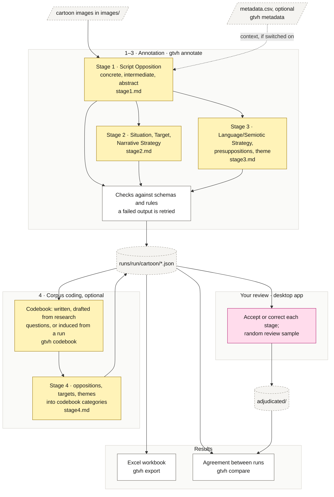

# GTVH Multimodal Analyzer

GTVH Multimodal Analyzer analyses humorous cartoons with the multimodal General Theory of Verbal Humour (GTVH). A vision-language model from Anthropic, OpenAI or Google annotates each cartoon through your own API key; you review and correct the results. The theoretical choices are explained in [Theory.md](Theory.md).

## Portable Desktop Version

Prefer not to deal with Python, virtual environments, or the command line? A portable desktop version of GTVH Multimodal Analyzer is available. It runs as a standalone application, so there is nothing to install or configure beyond your own API key.

The portable version is updated alongside every update to this repository, so it always matches the latest code.

To request a copy, email me at [iamahmadyasinedu@gmail.com](mailto:iamahmadyasinedu@gmail.com?subject=GTVH%20Multimodal%20Analyzer%20Portable%20Version%20Request) with the subject line: `GTVH Multimodal Analyzer Portable Version Request`.

## Pipeline

Each cartoon passes through three annotation stages, each a separate model call with its own prompt. Every output is checked before it is saved. You then review the annotations. An optional fourth stage codes the free-text labels into the categories of your codebook for corpus analysis.



**Key:** yellow boxes call the model (and cost tokens); white boxes are plain code (free, no API); the pink box is your manual step; dashed boxes are files. A codebook written by hand needs no model call.

## Quick start

```bash
git clone https://github.com/iamahmadyasin/gtvh-multimodal-analyzer.git
cd gtvh-multimodal-analyzer

python -m venv .venv
.venv\Scripts\activate                       # macOS/Linux: source .venv/bin/activate
pip install -e .

copy .env.example .env                       # macOS/Linux: cp .env.example .env
# edit .env and paste your Anthropic, OpenAI and/or Gemini API key

gtvh init my-study --name "My study"
cd my-study
# put the cartoon images into images/

gtvh metadata                                # optional: date, cartoonist, publication from file names
gtvh annotate --provider anthropic --max-items 5     # pilot on five cartoons
gtvh annotate --provider anthropic --batch           # all cartoons, about half price
gtvh export                                  # writes exports/<run>.xlsx
```

Every image in `images/` is a cartoon, identified by its file name. Runs can be stopped and started again; finished stages are skipped.

Options of `gtvh annotate`:

| Flag | Default | What it does |
|---|---|---|
| `--provider` | project default | `anthropic`, `openai` or `gemini` |
| `--model` | provider default | model id; `gtvh models PROVIDER` lists the ids your key can use |
| `--effort` | provider default | reasoning effort, e.g. `low`, `medium`, `high`; lower is cheaper |
| `--stage` | `1 2 3` | stages to run; add `4` for corpus coding |
| `--batch` | off | use the provider's batch API: about half price, results within 24 hours |
| `--ids`, `--max-items` | all | only these cartoons, or at most this many |
| `--force` | off | redo stages that already have output |
| `--retries` | 1 | extra attempts after an output fails its check |
| `--workers` | 4 | cartoons annotated in parallel (not in batch mode) |
| `--run` | `provider-model` | name of the run folder |
| `--dry-run` | off | write the assembled prompts without calling a model |

Other commands:

| Command | What it does |
|---|---|
| `gtvh init FOLDER` | create a project |
| `gtvh import PATH` | copy images into the project |
| `gtvh metadata` | fill `metadata.csv` from the image file names |
| `gtvh validate` | re-check outputs against the schemas and rules |
| `gtvh export`, `gtvh compare --runs A B` | Excel workbook per run; agreement between runs |
| `gtvh review sample\|summary --run RUN` | random review sample; review progress |
| `gtvh codebook draft\|induce\|accept` | build the Stage 4 codebook |
| `gtvh keys status`, `gtvh models PROVIDER` | where each API key is read from; available models |

Commands act on the project in the current folder; use `-p FOLDER` for another. `gtvh COMMAND -h` lists every option.

API keys are read from `.env` in the project folder or any folder above it, such as the repository root, or from environment variables. `gtvh keys set PROVIDER` stores a key in the operating system's credential store instead.

## Annotation Stages

| Stage | Annotates |
|---|---|
| 1 | Script Opposition |
| 2 | Situation, Target, Narrative Strategy |
| 3 | Language/Semiotic Strategy, Presuppositions, Theme |
| 4 | Optional Corpus Coding |

The codebook for Stage 4 can be written by hand, drafted from the research questions (`gtvh codebook draft`), or derived from a run's annotations (`gtvh codebook induce --run RUN`).

## Metadata

Annotation needs nothing but the images. To record dates, cartoonists and publications, name the files

```
DATE_CARTOONIST_PUBLICATION.png        e.g.  2024-03-15_paresh-nath_cagle.png
```

with underscores between the parts and hyphens between words; the publication is optional. `gtvh metadata` then writes `metadata.csv`, which you can also edit by hand. By default the model sees only the image; set `send_context: true` in `project.yaml` to also send each cartoon's metadata and the `corpus_context`.

## Cost

- **Batch mode** (`--batch`) costs about half as much. Results arrive within 24 hours; run the same command again to collect them.
- **Prompt caching:** the stage instructions are the same for every cartoon and are billed at the cached-input price after the first request.
- **Checks** of each output run locally at no cost. Only an output that fails a check is retried (`--retries 0` turns this off).

## Project Layout

```
gtvh-multimodal-analyzer/
├── gtvh/                     # the package behind the command line and the app
│   ├── resources/
│   │   ├── codebooks.yaml    # every closed code list with its definitions
│   │   ├── schemas.yaml      # output structure of each stage
│   │   ├── examples.yaml     # calibration examples (Tsakona 2009)
│   │   └── prompts/          # stage instructions; code tables are filled in from the YAML
│   ├── gui/                  # desktop app windows
│   ├── cli.py                # gtvh command
│   ├── framework.py          # builds prompts and schemas from resources/
│   ├── pipeline.py           # runs the stages, directly or in batches
│   ├── providers.py          # Anthropic, OpenAI and Gemini clients, API keys
│   ├── validate.py           # schema and rule checks
│   ├── project.py            # project folders, images and metadata
│   ├── codebook.py           # Stage 4 codebook drafting and induction
│   ├── review.py             # human review and the review sample
│   ├── export.py             # Excel export
│   ├── compare.py            # agreement between runs
│   └── update.py             # self-update of the desktop app
├── packaging/
│   ├── build.ps1             # builds the portable desktop version
│   ├── gtvh.spec             # PyInstaller specification
│   └── launch.py             # entry point of the desktop version
├── .env.example              # API key template; copy it to .env
├── CITATION.cff              # software citation
├── LICENSE
├── Theory.md                 # theoretical framework and references
├── pyproject.toml
└── README.md
```

A project created with `gtvh init`:

```
my-project/
├── project.yaml              # settings: name, description, research questions, defaults
├── images/                   # the cartoons
├── metadata.csv              # optional: date, cartoonist, publication, notes per image
├── codebook.yaml             # optional: Stage 4 categories
├── runs/<run>/<cartoon>/     # model annotations, one JSON file per stage, plus logs
├── adjudicated/<cartoon>/    # your reviewed versions
└── exports/                  # Excel workbooks
```

## Acknowledgments

GTVH Multimodal Analyzer was designed and developed by **Ahmad Yasin**, as part of his MPhil research at Government College University Faisalabad.

- **Dr. Asim Mahmood**, Dean of the Faculty of Arts and Social Sciences, Government College University Faisalabad, supervised the research on which this tool is based.
- **Prof. Salvatore Attardo**, East Texas A&M University, kindly answered questions by email during the development of the framework.
- **Nasir Saim**, a doctoral researcher in GCUF working on multimodal humour analysis, gave advice and helpful conversations along the way.

## Associated Research

This software is the practical implementation of the author's MPhil research. If you use it in academic work, please cite the thesis and the software.

> Yasin, A. (2025). *Augmenting LLMs with General Theory of Verbal Humor for multimodal humor analysis* [Unpublished MPhil thesis]. Government College University Faisalabad.

## Software Citation

To cite the software itself, use the [`CITATION.cff`](./CITATION.cff) file in this repository, or the following reference:

> Yasin, A. (2026). *GTVH Multimodal Analyzer: A Tool for Multimodal Analysis of Humorous Cartoons Using the General Theory of Verbal Humor* (Version 1.0.0) [Computer software]. GitHub. https://github.com/iamahmadyasin/gtvh-multimodal-analyzer

## License

MIT — see [`LICENSE`](./LICENSE).
